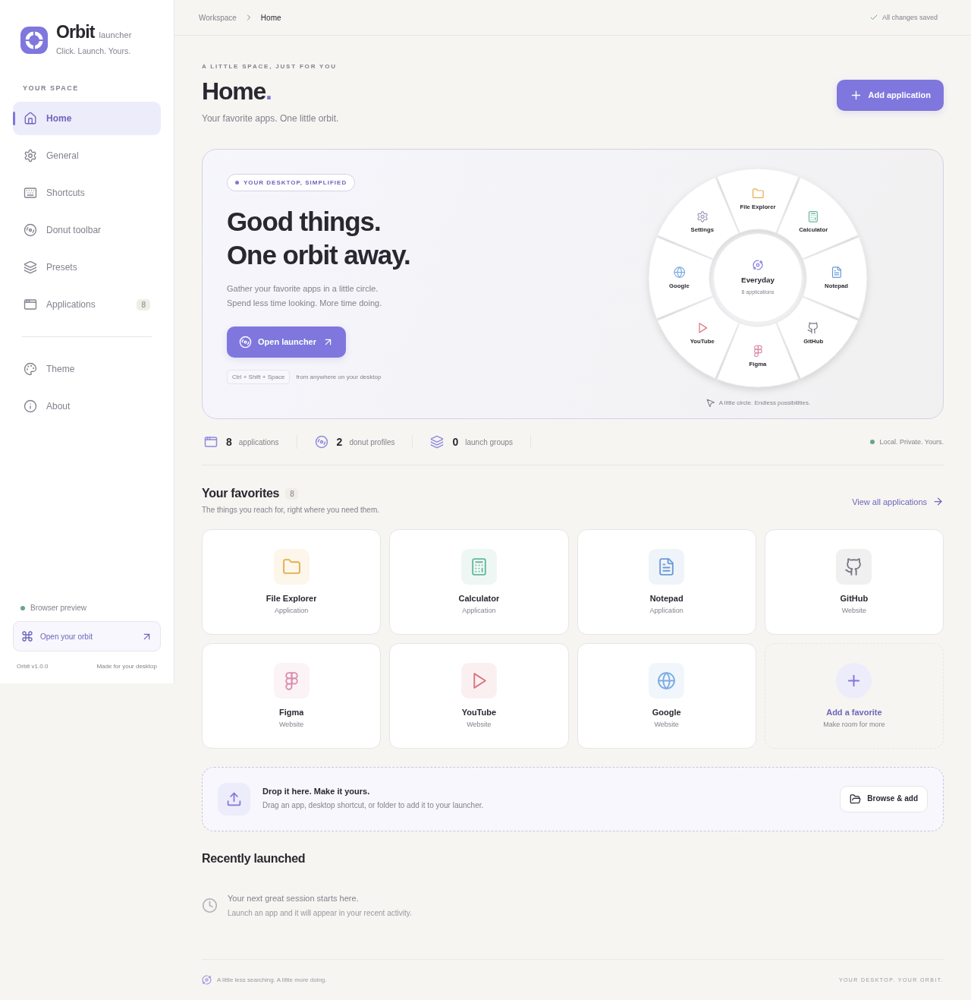

# Orbit Launcher

A customizable Windows desktop launcher inspired by [Filee](https://github.com/KnifeLemon/Filee). Your apps, folders, websites, and launch groups live in a donut that opens at your cursor.

Built in the `vmrishi/Launcher` checkout. This is an independent Electron/React launcher with a port of Filee's soft settings design, rather than the upstream Avalonia converter. The MIT license and source attribution are included. See [the design analysis](docs/FILEE-ANALYSIS.md).



[Donut editor](docs/screenshots/donut-editor.png) · [Dark theme](docs/screenshots/theme-dark.png)

## What is implemented

- **Home:** live donut, favorites, drag/drop app addition, recent successful/failed launches.
- **General:** launch at Windows sign-in, start minimized, close to tray, auto-hide, default profile, backup import/export.
- **Shortcuts:** configurable global donut shortcut and individual app/group hotkeys, with conflict detection.
- **Donut toolbar:** create, rename, duplicate, and delete profiles; drag apps onto slices; rearrange; drag a slice back into the library to remove it; button alternatives; front/back/additional faces.
- **Presets:** one-click multi-app launch groups with ordered members and a configurable delay. Missing apps do not stop the remaining group members.
- **Applications:** executable/shortcut/folder/URL entries; edit/delete; favorites; search; native file picker; Windows Start Menu discovery; automatic or custom icons; literal arguments and working directory.
- **Theme:** Soft/Material appearance, light/dark/system mode, eight accents and a color picker, corner softness, donut transparency, reduced motion, live preview.
- **Native shell:** cursor-positioned always-on-top donut, tray menu, single-instance behavior, keyboard navigation, persistent local JSON settings with a rolling backup.

No conversion engine, cloud service, account, API key, or external database is required.

## Start on Windows (development)

Requires **Windows 10/11 x64** and **Node.js 24 LTS** with npm. Git is needed only to clone the repository.

```powershell
cd Launcher
npm ci
npm run desktop:dev
```

The first command installs the locked dependencies, including Electron. The second starts Vite and the desktop application together. Press **Ctrl + Shift + Space** to open the donut at your mouse cursor. Click the tray icon to open it, or double-click the tray icon for settings.

For a production local run:

```powershell
npm run build
npm start
```

`npm run dev` starts the browser UI preview. It saves to that browser's localStorage and deliberately does **not** execute native applications, register system shortcuts, scan the Start Menu, import native settings, or set Windows startup. A notification explains this when a native action is requested. Browser preview settings and desktop settings are separate.

## Build the Windows application

On Windows:

```powershell
npm ci
npm test
npm run dist:win
```

Output in `release/`:

- `Orbit-Launcher-1.0.0-x64-Setup.exe`: install/uninstall wizard, Start Menu and desktop shortcut, selectable installation folder.
- `Orbit-Launcher-1.0.0-x64-Portable.exe`: self-extracting portable executable, no install wizard.
- `win-unpacked/`: unpacked runnable application.

Portable refers to deployment: **settings still live in the Windows user profile**, not beside the executable. Both editions use the same application ID and enforce a single running instance.

These builds are **unsigned**. The project has no signing certificate configured. Windows signing, SmartScreen reputation, and native OS acceptance must be addressed before public distribution. The packaging uses `signExecutable: false` while retaining executable icon and metadata editing. For a signed release, remove that override and configure your own Windows signing in your release pipeline. Build NSIS installers on Windows. Linux can build the portable target with `npm run dist:portable`; NSIS cross-builds also require a working Wine runtime.

A Windows GitHub Actions workflow is included at `.github/workflows/windows.yml`. It runs tests and creates downloadable installer artifacts; it does not publish a GitHub release automatically.

## Make it yours, from first launch

1. **Add your apps.** In Home or Applications, choose **Add application**. Select Application, Website, or Folder. Browse to an `.exe`, `.com`, `.lnk`, or `.url` file, enter a website, or drag a file onto the editor card. Drop multiple shortcuts into Home or the application library to add them in a batch.
2. **Discover installed software.** In Applications choose **Discover apps**. Orbit searches your user and all-users Start Menu folders for shortcuts (up to 500). Select what you want and add it. If software has no Start Menu shortcut, use Browse.
3. **Customize each entry.** Set its name, icon, icon color, favorite flag, and optional global shortcut. You can supply executable arguments as a JSON array, for example `["--new-window", "C:\\Projects\\demo"]`. `.lnk/.url` files use their own launch options.
4. **Arrange the donut.** Open Donut toolbar. Choose Everyday, Work, or create a profile. Drag apps from the right library into the donut. Drop one slice on another to move it. Drag a slice back into the library to remove it. The `+`/check buttons are accessible alternatives.
5. **Choose how it looks.** Show icons, app names, or both. Set 4, 6, 8, 10, or 12 apps per face, size, rotation, and opacity. Each profile holds up to 24 entries; additional entries stay in the application library.
6. **Create a one-click workspace.** In Presets choose **New launch group**. Add apps, order them with the arrows, and choose a delay (0–10 seconds). Save it. The group can be launched directly, added to profiles like any other entry, or assigned a shortcut.
7. **Pick a theme.** Open Theme and change Soft/Material, Light/Dark/System, accent, radius, opacity, and motion. The preview updates immediately and changes save automatically.
8. **Use it anywhere.** Set a global shortcut in Shortcuts. Open the donut, select a slice, and continue working. Mouse wheel or Page Up/Down switches faces. Tab focuses slices; Enter/Space launches. Escape hides the donut. Profiles can also be changed from the tray menu or floating donut.
9. **Back up your setup.** General → Export settings. Import validates the JSON and asks before replacing your library. Launch history is excluded from exports. Import does not change your existing Windows sign-in setting.

The seeded Windows utilities assume `C:\Windows`; edit their paths if Windows is installed elsewhere. Starter websites are real URL entries. Unknown third-party executables are not prefilled with guessed locations.

## Data and behavior

Desktop settings are stored at Electron's `app.getPath('userData')`, normally `%APPDATA%\orbit-launcher\settings.json`. A successful subsequent write copies the previous version to `settings.json.bak` before replacing the current JSON file. To recover from a corrupted file, quit Orbit, preserve the broken file, and copy the backup to `settings.json`. A corrupt settings file is reported and preserved rather than silently reset.

Orbit retains at most 100 launch records. Clear activity in Home, or turn off its display in General. Imported settings never automatically run targets. App launches use an argument array with `shell: false`; no shell-command field is provided. A successful launch means the OS accepted opening the target or the process emitted `spawn`; it does not prove the launched application finished initializing successfully.

Limitations: no UWP/package-app enumeration, no simulated Filee Ctrl-drag system hook, no nested launch groups, no administrator-elevation toggle, no auto-updater, no signing certificate. Use a Start Menu `.lnk` for Store apps when one exists. Startup and tray behavior are Windows-specific and need validation on an actual Windows desktop before release.

## Tests and validation

```powershell
npm test
npm run build
npx playwright install chromium
npm run test:ui
```

On Linux the UI tests use `/usr/bin/chromium` by default. Override with `PLAYWRIGHT_CHROMIUM_EXECUTABLE` if needed; on Windows/macOS Playwright uses its installed Chromium. `npm run check` combines the core tests, TypeScript/production build, and UI tests.

Core tests cover persistence, invalid imports, group references, failed targets, literal process arguments, group ordering/delays, and a real spawned process. Playwright covers all menu pages, app CRUD, saved settings across reloads, theme options, profile editing, drag/drop, groups, deletion cleanup, and responsive layout. See [validation notes](docs/VALIDATION.md) for the actual run results and platform limits.

## Project map

```text
src/                     React/TypeScript settings and floating donut
  App.tsx                Navigation, pages, saved state orchestration
  components/            SVG donut, app editor, accessible controls
  styles.css             Filee-derived palette + launcher visual design
electron/
  main.cjs               Windows shell, tray, shortcuts, IPC, discovery
  preload.cjs            Restricted context-isolated renderer bridge
  schema.cjs             Import and settings validation
  store.cjs              Local settings and backup writes
  launcher.cjs           Native launch and group execution
public/                  Original Orbit icon
scripts/                 Cloud installation and native smoke checks
tests/                   Core and browser integration tests
docs/                    Design analysis, validation, source references
```

Development architecture and extension guidance: [docs/DEVELOPMENT.md](docs/DEVELOPMENT.md). License: [MIT](LICENSE). Credits: [third-party notices](THIRD-PARTY-NOTICES.md).
